# Heart Disease Risk Prediction – End-to-End MLOps Pipeline

**Course:** AIMLCZG523 Machine Learning Operations – Assignment 01
**Student:** Tilak (B. Mamidipalli) · **BITS ID:** <your-id>
**Repository:** <https://github.com/your-username/heart-mlops>
**Date:** October 2026

## 1. Introduction and objective

The goal is to build a classifier that predicts the presence of heart disease from routine
clinical measurements and to operate it the way a production model would be operated: the data
download, training, evaluation, packaging, testing, container build, deployment and monitoring are
all automated and reproducible from a clean checkout.

The solution is organised as a Python package (`src/heart`) used by every stage — notebooks,
training CLI, unit tests and the API — so there is exactly one implementation of the
cleaning and feature logic. The architecture is shown in Figure 1.

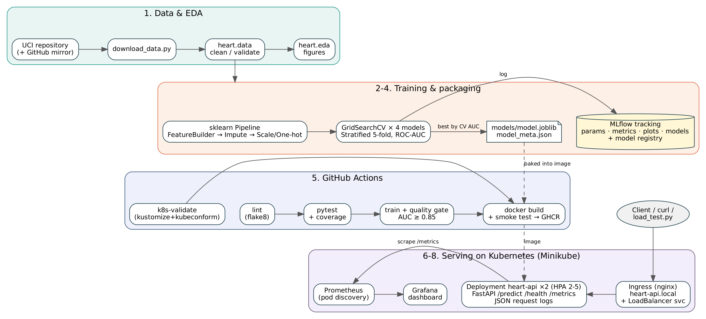

## 2. Setup and installation

| Step | Command |
|------|---------|
| Create environment | `python3.11 -m venv .venv && source .venv/bin/activate` |
| Install | `pip install -r requirements-dev.txt` (or `conda env create -f environment.yml`) |
| Data | `make data` |
| EDA | `make eda` |
| Train + MLflow | `make train`, then `make mlflow` (UI on port 5000) |
| Tests / lint | `make test`, `make lint` |
| Container | `make docker-build docker-run smoke` |
| Monitoring stack | `docker compose up -d --build` |
| Kubernetes | `./scripts/deploy_minikube.sh` |

Dependencies are pinned in three layers: `requirements-serve.txt` (only what the API needs — keeps
the image small), `requirements.txt` (adds training, plotting and MLflow) and `requirements-dev.txt`
(adds pytest, flake8, Jupyter).

## 3. Data acquisition and EDA

### 3.1 Acquisition

`scripts/download_data.py` downloads `processed.cleveland.data` from the UCI repository. Because
UCI is sometimes blocked by corporate proxies, the script falls back to a GitHub mirror of the same
303 records and maps its text labels back to the UCI numeric codes, so the output schema is
identical either way. The result is `data/raw/heart_raw.csv` with 14 columns.

### 3.2 Cleaning

Cleaning (`heart.data.clean`) is intentionally stateless:

- `?` markers become NaN (4 in `ca`, 2 in `thal`);
- the target `num` (0–4) is binarised to `target = num > 0`;
- out-of-range values (e.g. cholesterol = 0) and unknown category codes become NaN;
- exact duplicates are removed (none found).

Imputation is deferred to the model pipeline (median for continuous, mode for categorical) so
that it is learned on training folds only and travels with the model — this avoids leakage and
guarantees the API treats missing `ca`/`thal` exactly as training did. The cleaned file is
`data/processed/heart_clean.csv` (303 rows).

### 3.3 Exploratory analysis

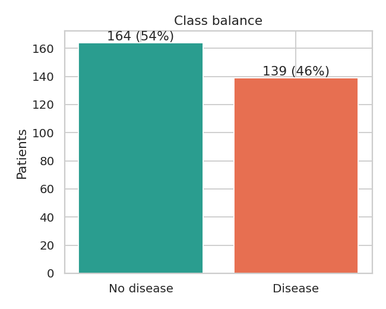

The classes are close to balanced (164 without disease, 139 with disease; 45.9 % positive), so
accuracy is meaningful, but ROC-AUC is used for model selection because it is threshold-free.

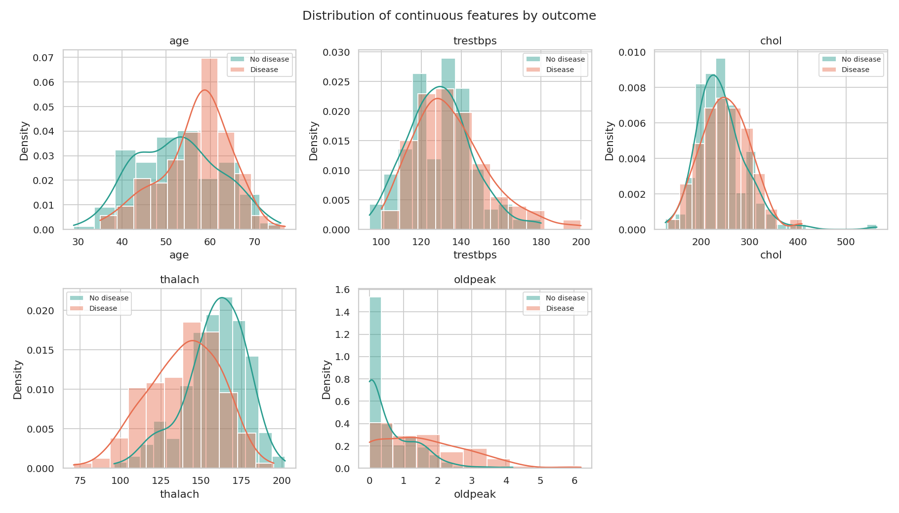

Patients with disease reach a lower maximum heart rate (`thalach`) and show larger exercise ST
depression (`oldpeak`). `chol` and `trestbps` overlap heavily between classes.

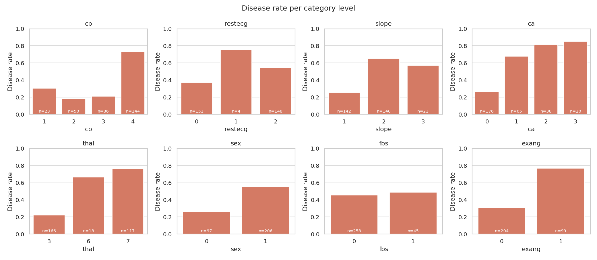

Asymptomatic chest pain (`cp = 4`), reversible thalassemia defect (`thal = 7`), more coloured
vessels (`ca`) and exercise angina all carry a disease rate above 70 %. `restecg = 1` has only 4
patients, so its high rate is not reliable — this is one reason for one-hot encoding with
`handle_unknown="ignore"` and regularised models.

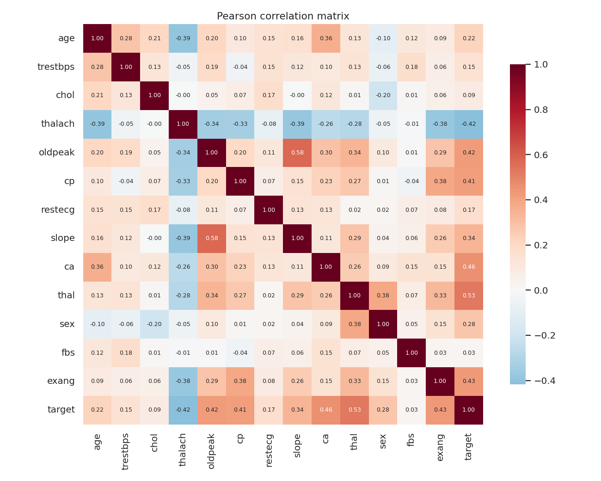

The strongest absolute correlations with the target are `thal` (0.53), `ca` (0.46), `exang`
(0.43), `oldpeak` (0.43), `thalach` (0.42) and `cp` (0.41). No pair of predictors is so strongly
correlated that it would need to be dropped.

## 4. Feature engineering and model development

### 4.1 Features

The preprocessing is a single scikit-learn `Pipeline`:

1. `HeartFeatureBuilder` (custom transformer) adds three derived features:
   `hr_reserve_pct = thalach / (220 − age)` (share of age-predicted maximum heart rate reached),
   `chol_per_age = chol / age`, and `st_risk_flag = 1 if oldpeak ≥ 2 or exang = 1`.
2. `ColumnTransformer`:
   continuous → median imputation + `StandardScaler`;
   `cp`, `restecg`, `slope`, `ca`, `thal` → mode imputation + one-hot;
   `sex`, `fbs`, `exang` → mode imputation (already 0/1).
3. Estimator.

### 4.2 Candidate models and tuning

| Candidate | Search space | Purpose |
|-----------|--------------|---------|
| logreg_baseline | C ∈ {0.01…10}, L1/L2; **no engineered features** | Ablation |
| logreg | C ∈ {0.01…3}, L1/L2, class_weight ∈ {None, balanced} (24 combos) | Interpretable linear model |
| random_forest | n_estimators, max_depth, min_samples_leaf, max_features (36 combos) | Non-linear bagging |
| gradient_boosting | n_estimators, learning_rate, max_depth, subsample (16 combos) | Non-linear boosting |

Data is split 80/20 (stratified, seed 42). Each candidate is tuned with `GridSearchCV` on the
training split using stratified 5-fold CV and ROC-AUC. The best configuration is then
cross-validated again for accuracy, precision, recall, F1 and ROC-AUC (mean ± std), and finally
scored once on the 61-patient hold-out set. **Selection rule:** highest mean CV ROC-AUC; the
hold-out set is never used for selection.

### 4.3 Results

| Model | CV accuracy | CV precision | CV recall | CV ROC-AUC | Test accuracy | Test recall | Test ROC-AUC |
|-------|-------------|--------------|-----------|------------|---------------|-------------|--------------|
| logreg_baseline | 0.847 ± 0.010 | 0.877 | 0.783 | 0.905 ± 0.015 | 0.885 | 0.929 | 0.969 |
| **logreg (selected)** | 0.839 ± 0.016 | 0.870 | 0.774 | **0.905 ± 0.013** | 0.885 | 0.929 | **0.970** |
| random_forest | 0.814 ± 0.029 | 0.819 | 0.765 | 0.895 ± 0.024 | 0.885 | 0.929 | 0.961 |
| gradient_boosting | 0.814 ± 0.028 | 0.822 | 0.774 | 0.881 ± 0.026 | 0.902 | 0.929 | 0.958 |

Selected hyper-parameters: `C = 0.3`, `penalty = l1`, `class_weight = balanced`.

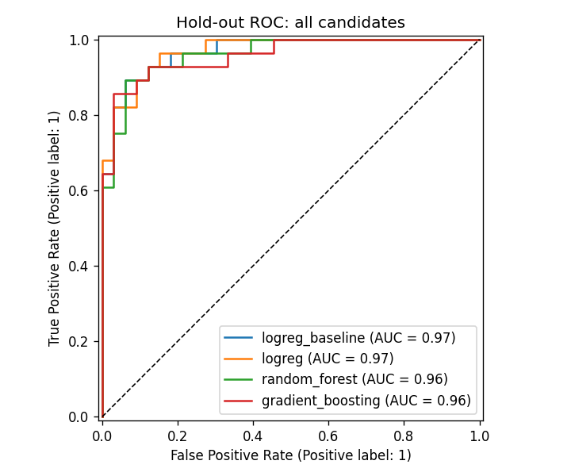

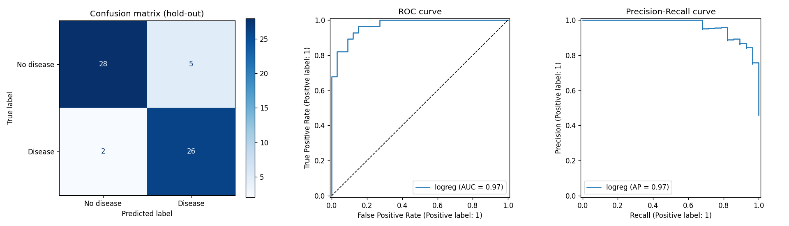

**Discussion.** On 303 patients the linear models beat both tree ensembles in cross-validation
and have lower variance across folds. The two logistic-regression variants are statistically
indistinguishable (difference 0.001 AUC, well within one standard deviation), which means the
engineered features add little on top of the raw codes; the L1 penalty in fact set
`hr_reserve_pct` and `chol_per_age` to zero and kept only `st_risk_flag`. The selected model was
kept because it is the rule-based winner, is fully interpretable (largest coefficients:
`cp = 4`, `thal = 7`, `sex`, `ca = 0` with a negative sign), and its `balanced` class weight
favours recall — on the hold-out set it misses only 2 of 28 disease cases. Hold-out scores are
higher than CV scores because the test split is small (61 rows); the CV figures are the more
reliable estimate.

## 5. Experiment tracking (MLflow)

Every execution of `python -m heart.train` creates one parent run (`session-<timestamp>`) with
dataset size, split and seed parameters and the cleaned dataset as an artifact. Each candidate
is a nested child run that logs:

- **params:** best hyper-parameters, grid size, whether engineered features were used;
- **metrics:** `cv_*_mean`/`cv_*_std` for five metrics, `test_*` hold-out metrics, search time;
- **artifacts:** full grid-search results CSV, evaluation plot, feature-importance plot, and the
  fitted pipeline as an MLflow model with an inferred signature and an input example.

The parent run additionally stores the model comparison table, the ROC overlay and the exported
`model_meta.json`, and tags the selected model. The winner is registered as
`heart-disease-classifier` in the MLflow model registry.

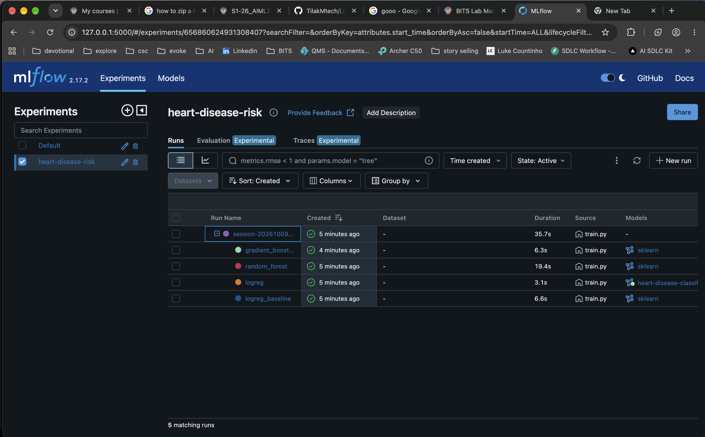

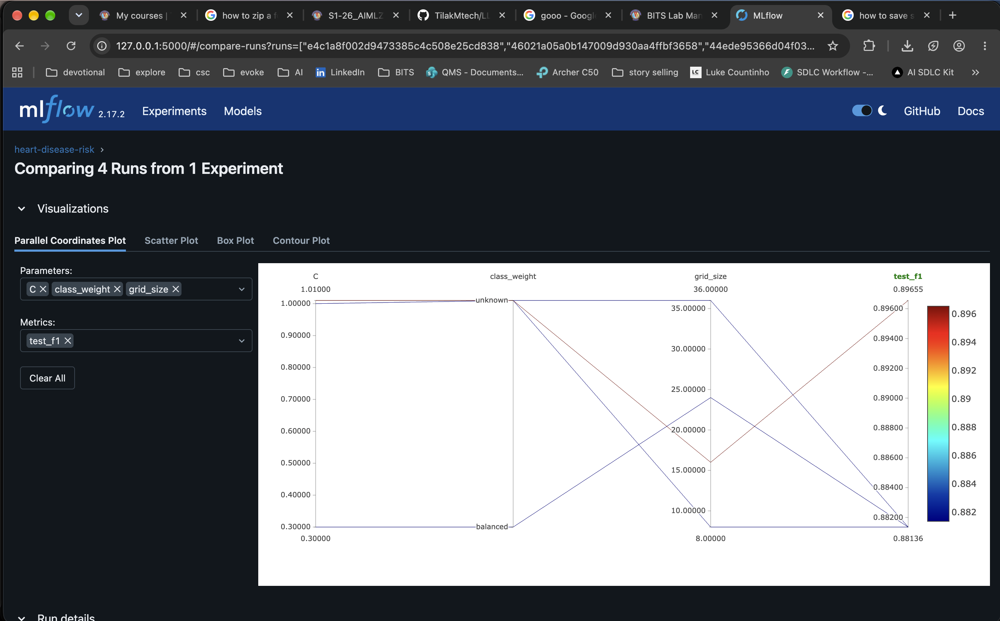

## 6. Model packaging and reproducibility

- The complete pipeline (feature builder, imputers, scaler, encoder and classifier) is saved as
  one object in `models/model.joblib`; the same model is also stored in MLflow format.
- `models/model_meta.json` records model name, version, MLflow run IDs, hyper-parameters,
  metrics, the input feature order, decision threshold and the scikit-learn version.
- All random seeds are fixed (`RANDOM_STATE = 42`), library versions are pinned, and every stage
  runs from a clean environment with `make install data train`.
- `heart.predict.HeartRiskModel` is the only inference code path; the notebooks, CLI and API all use it.

## 7. CI/CD pipeline and automated testing

### 7.1 Tests

The `tests/` folder contains 37 pytest tests that need no network or real dataset (they use a
synthetic fixture):

- **data:** target binarisation, `?` handling, out-of-range nulling, duplicates, schema errors;
- **features:** derived-feature formulas, no NaNs after preprocessing, scaling, unseen categories;
- **model:** pipeline fit/predict for LR and RF, learnability check, candidate registry, inference wrapper;
- **API:** health, prediction contract, optional fields, validation errors (422), batch, metrics, 503 without a model.

### 7.2 GitHub Actions workflow

| Job | Steps | Artifacts |
|-----|-------|-----------|
| lint | flake8 | `flake8-report.txt` |
| k8s-validate | kustomize build, kubeconform (k8s 1.31 schemas) | rendered manifests |
| test | pytest + coverage | JUnit XML, coverage XML |
| train | download → EDA → train → quality gate (CV AUC ≥ 0.85) → job summary | model, MLflow store, reports, logs |
| docker | build image with new model → run → smoke test → push to GHCR (main) | container logs |

Jobs are chained with `needs`, so a lint error, a failing test, a model below the quality gate or
a failing smoke test stops the pipeline with a red status and clear logs.

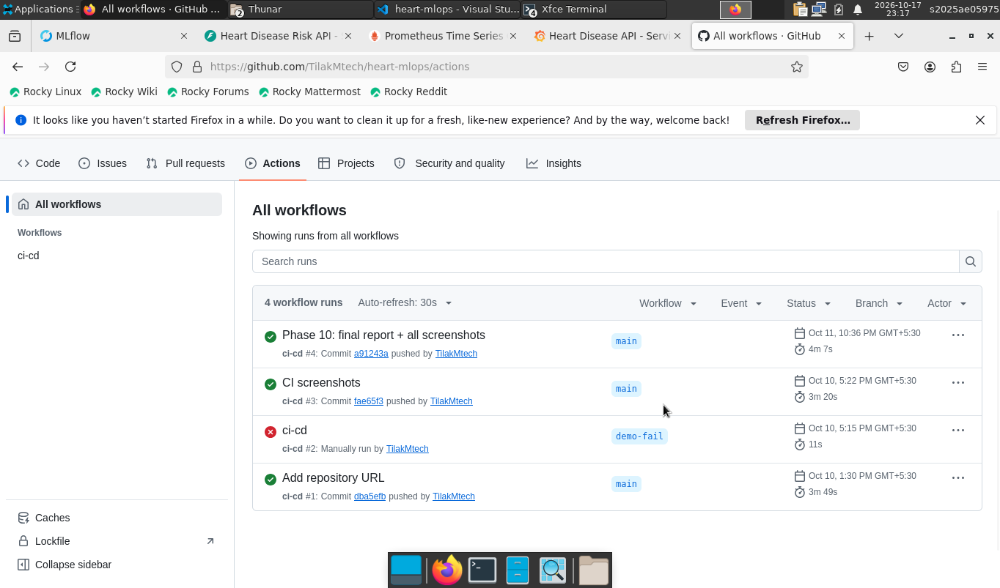

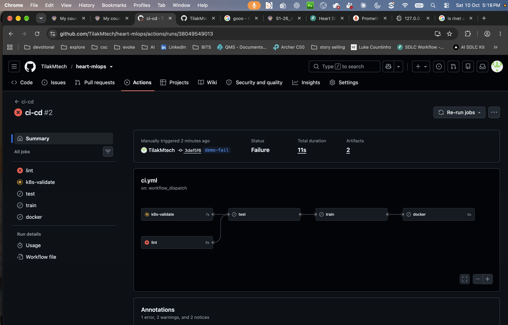

## 8. Model containerisation

The `Dockerfile` uses `python:3.11-slim`, installs only `requirements-serve.txt`, copies the
package, API and model, runs as a non-root user (UID 1001) and defines a `HEALTHCHECK` on
`/health`. One Uvicorn worker runs per container so Prometheus counters stay consistent;
scaling is done with Kubernetes replicas.

API contract:

| Endpoint | Purpose |
|----------|---------|
| `POST /predict` | One patient JSON → `prediction`, `label`, `probability_disease`, `confidence`, `risk_band`, `model_version`, `request_id` |
| `POST /predict/batch` | Up to 500 records |
| `GET /health` | 200 when the model is loaded, 503 otherwise |
| `GET /metrics` | Prometheus exposition |
| `GET /docs` | Swagger UI |

Inputs are validated by pydantic (ranges and allowed codes); invalid input returns 422.
`ca` and `thal` are optional and imputed by the pipeline. `scripts/smoke_test.sh` verifies all
of this against a running container.

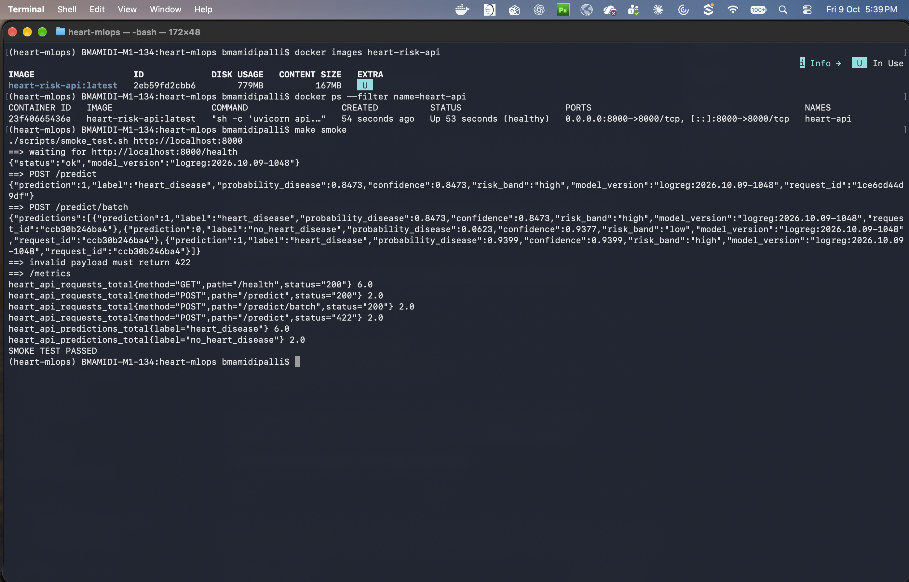

## 9. Production deployment (Kubernetes / Minikube)

Manifests in `k8s/` are applied with Kustomize (`kubectl apply -k k8s/`):

- **Namespace** `heart-mlops`;
- **Deployment** – 2 replicas, rolling update with `maxUnavailable: 0`, readiness and liveness
  probes on `/health`, CPU/memory requests and limits, non-root security context, Prometheus
  scrape annotations;
- **Service** of type `LoadBalancer` (external IP through `minikube tunnel`);
- **Ingress** (NGINX) on host `heart-api.local`;
- **HorizontalPodAutoscaler** 2–5 replicas at 70 % CPU.

`scripts/deploy_minikube.sh` performs the whole flow: start Minikube, enable add-ons, build and load
the image, apply manifests, wait for rollout and run the smoke test against the service URL.

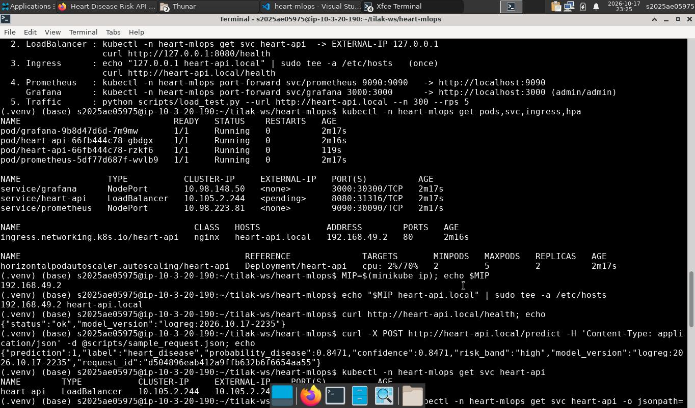

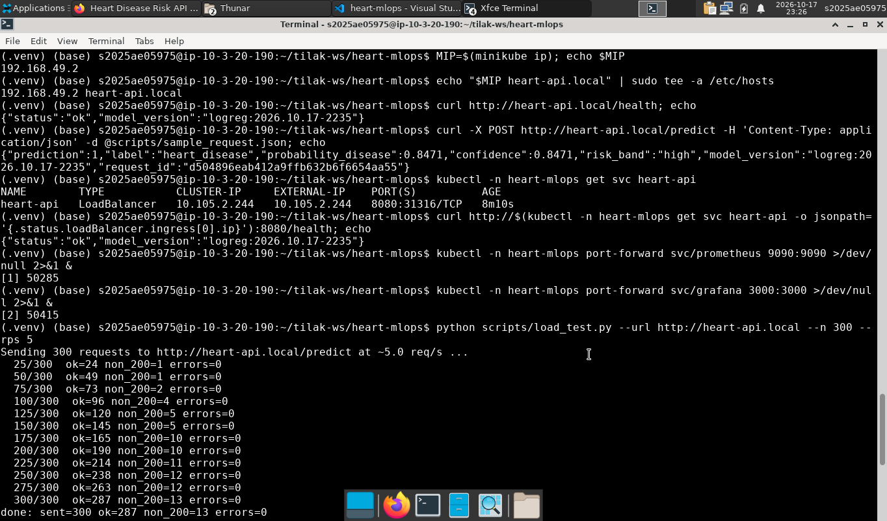

## 10. Monitoring and logging

- **Logging:** a middleware writes one JSON line per request (request ID, method, path, status,
  latency, client) and one per prediction (inputs, probability, label). The request ID is
  returned in the `x-request-id` header so a client can trace its call in `kubectl logs`.
- **Metrics:** `heart_api_requests_total{method,path,status}`,
  `heart_api_request_latency_seconds` (histogram), `heart_api_predictions_total{label}`,
  `heart_api_disease_probability` (histogram) and `heart_api_model_info{version}`.
- **Prometheus** discovers the API pods through their annotations (pod service discovery with
  RBAC); for local use, `docker-compose.yml` runs the same stack.
- **Grafana** is provisioned automatically with a dashboard showing total predictions, request
  rate, p95 latency, error rate, latency percentiles, predictions per class, and the mean predicted
  probability as a simple drift signal — a sustained shift in that line means the incoming
  patient mix has changed and the model should be reviewed.

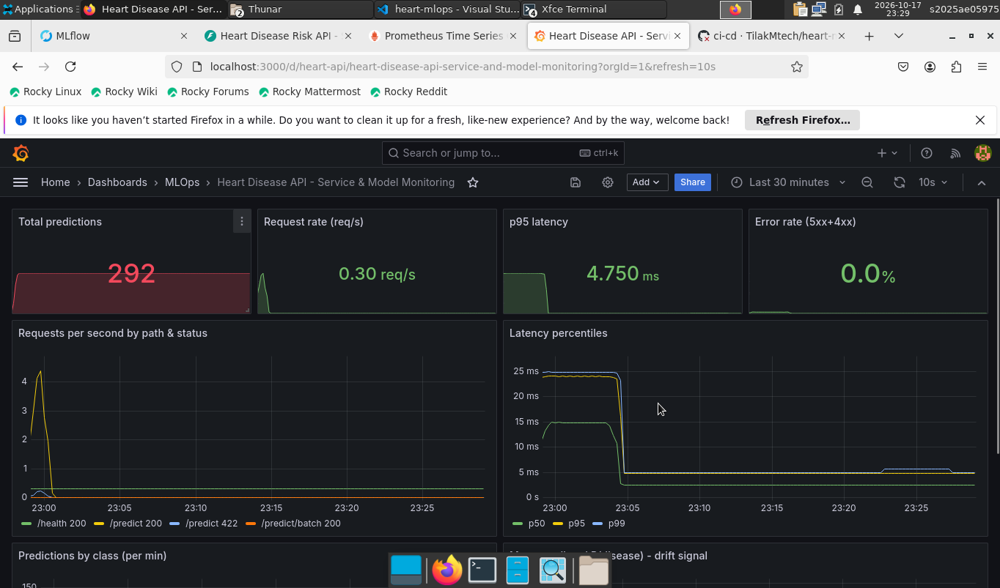

## 11. Conclusions and future work

The project delivers a reproducible pipeline from raw data to a monitored API on Kubernetes,
with a regularised logistic regression reaching 0.905 CV ROC-AUC and 93 % hold-out recall.
Possible next steps: probability calibration and a recall-oriented decision threshold, data-drift
tests (e.g. PSI per feature) on logged requests, a remote MLflow tracking server with a model
promotion workflow, and a Helm chart with separate environments.

## 12. Links

- Code repository: <https://github.com/your-username/heart-mlops>
- API access: see README §6–7 (local Docker on port 8000, or Minikube service / Ingress `heart-api.local`)
- Demo video: <link to your recording>
